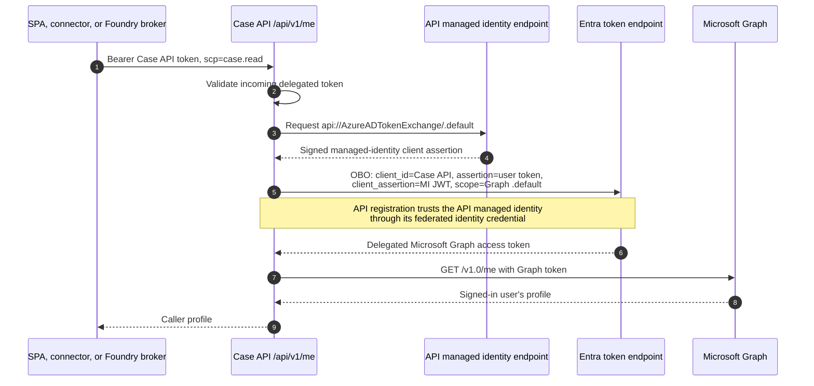
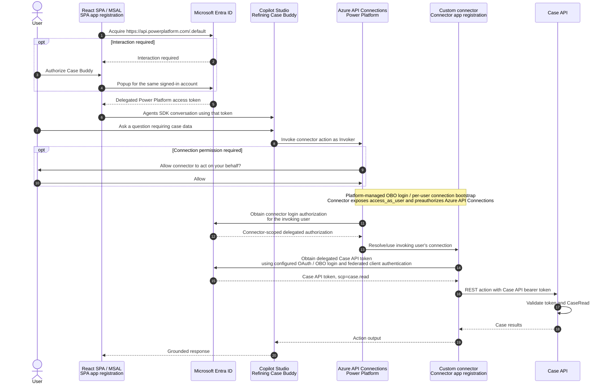
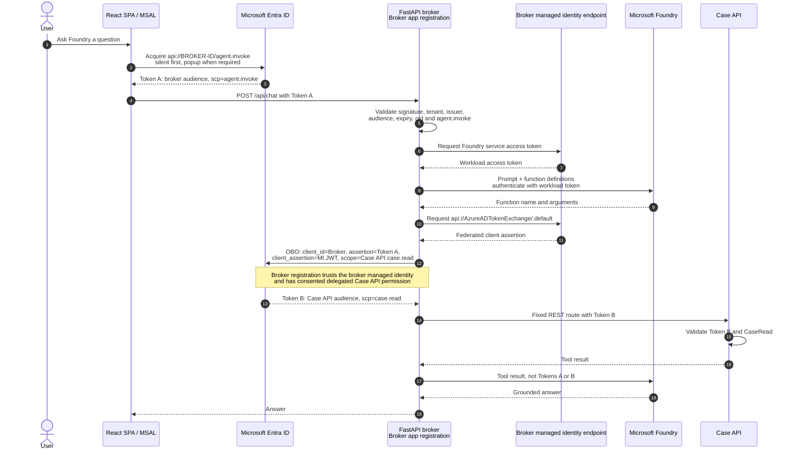
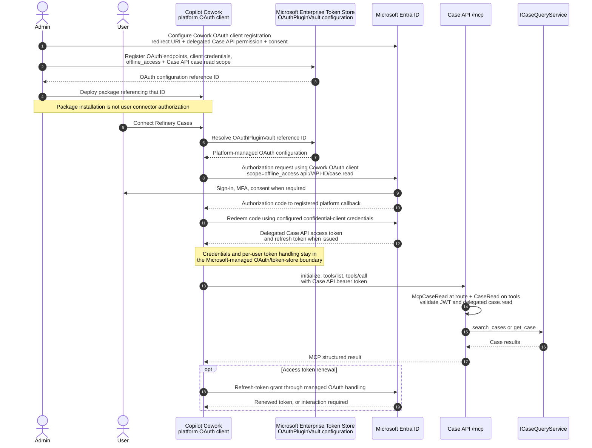
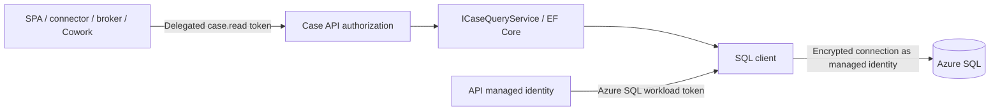

# Authentication and OBO

This is the authoritative description of identity and token handling in the case app. Deployment steps are in [Azure deployment](azure-deployment.md); connector-specific setup is in [Power Platform and Refining Case Buddy](power-platform.md).

## Authentication map

The diagrams describe the checked-in implementations and documented lab configuration, not a fresh inspection of the deployed tenant. Names in angle brackets are placeholders, not actual registration IDs. Microsoft-managed connector internals are shown as logical operations, not a captured token trace.

| Implementation | Client registration | Resource registration / audience | Client authentication |
|---|---|---|---|
| [React SPA](#1-react-spa-to-case-api) | SPA | Case API, delegated `case.read` | Public client: authorization code with PKCE; no browser client secret |
| [Copilot Studio](#2-copilot-studio-and-power-platform-connector) | SPA for chat; separate custom-connector registration for actions | Power Platform for chat; connector `access_as_user` for login bootstrap; Case API `case.read` for actions | MSAL in browser; documented lab connector uses Power Platform managed-identity federation |
| [Foundry broker](#3-foundry-agent-broker) | SPA, then broker acting as a confidential client | Broker `agent.invoke`, then Case API `case.read` | Broker managed identity supplies a federated client assertion for OBO |
| [Copilot Cowork MCP](#4-copilot-cowork-mcp) | Dedicated Cowork OAuth client configured in Microsoft Enterprise Token Store | The same Case API registration, delegated `case.read` | Platform-managed OAuth authorization-code/refresh flow; client secret held in the token store |
| [API to Microsoft Graph](#microsoft-graph-on-behalf-of-flow) | Case API acting as a confidential client | Microsoft Graph | API managed identity supplies a federated client assertion for OBO |

An **app registration** defines an application's identity, exposed scopes, redirect URIs, and credentials/trust. Its tenant **service principal** represents the application in permission grants. A **managed identity** is a separate workload identity; federation lets an app registration trust it without giving that app a client secret.

For Cowork, keep three identifiers distinct:

- **Plugin package ID**: the stable GUID in the Microsoft 365 app manifest.
- **OAuth client ID**: the Entra registration used to obtain Case API tokens.
- **OAuth configuration reference ID**: the token-store record selected by `OAuthPluginVault`; this is not either application ID.

## API token validation

The SPA, Power Platform connector, and hosted MCP clients call the Case API on behalf of a signed-in user. Their access token must contain the delegated `case.read` scope.

The API validates:

- Signature and expiry
- Tenant and issuer
- Delegated `case.read` scope
- Audience matching the API registration

Microsoft Entra and Power Platform can represent the same API audience as either `api://<API-CLIENT-ID>` or the client-ID GUID. The API accepts only those two canonical values for its registration.

## Microsoft Graph on-behalf-of flow

`GET /api/v1/me` preserves the caller's identity while calling Microsoft Graph:

1. The client sends a delegated Case API token.
2. The API validates the token and uses it as the OBO user assertion.
3. The API obtains a client assertion from its user-assigned Azure managed identity.
4. Entra exchanges both assertions for a delegated Microsoft Graph token.
5. The API calls Microsoft Graph `/v1.0/me` and returns the caller profile.

OBO requires both the user assertion and confidential-client authentication. This project uses managed-identity workload federation for the latter, not an API client secret.

The federated credential on the API registration uses:

| Claim | Value |
|---|---|
| Issuer | Tenant v2 issuer, `https://login.microsoftonline.com/<TENANT-ID>/v2.0` |
| Subject | User-assigned managed identity principal ID |
| Audience | `api://AzureADTokenExchange` |

The API requests `api://AzureADTokenExchange/.default` from managed identity and sends the returned JWT as its OBO `client_assertion`.



The managed-identity assertion authenticates the **application**; the incoming access token supplies the **user**. Neither alone is the downstream delegated Graph token. This exchange runs for `/api/v1/me`, not for ordinary case reads or the current MCP tools.

## Identity boundaries

There are several distinct delegated tokens:

| Token | Used for |
|---|---|
| Case API token | SPA, connector, or MCP client calling the API |
| Power Platform token | SPA opening the embedded Copilot Studio agent |
| Connector login token / `access_as_user` | Platform-managed connector OBO login bootstrap; not a token the SPA sends to the Case API |
| Broker token / `agent.invoke` | SPA calling the Foundry broker; exchanged for a Case API token |
| Microsoft Graph token | API calling Graph through OBO |

These tokens are not interchangeable. Scope names are permission requests/claims; they aren't token audience values. The Case API accepts its configured identifier URI or client-ID GUID as audience, not the SPA, broker, or Cowork OAuth client ID.

Managed-identity tokens for Foundry, Azure SQL, and client assertions are workload credentials, not additional user-delegated Case API tokens.

## 1. React SPA to Case API

The SPA uses [MSAL configuration](../src/web/src/auth.ts) and sends bearer tokens through the [REST client](../src/web/src/api.ts).

```mermaid
sequenceDiagram
    autonumber
    actor User
    participant SPA as React SPA / MSAL<br/>SPA app registration
    participant Entra as Microsoft Entra ID
    participant API as Case API<br/>Case API app registration
    participant Data as ICaseQueryService
    User->>SPA: Sign in
    SPA->>Entra: Authorize SPA client<br/>scope=api://API-ID/case.read, PKCE challenge
    Entra->>User: Sign-in, MFA, consent when required
    Entra-->>SPA: Authorization code to SPA redirect URI
    SPA->>Entra: Redeem code + PKCE verifier<br/>no client secret
    Entra-->>SPA: Delegated Case API access token
    Note over SPA,Entra: Subsequent acquireTokenSilent calls reuse valid<br/>MSAL state; interaction is requested when required
    SPA->>API: GET /api/v1/cases with bearer token
    API->>API: Validate signature, issuer, audience,<br/>expiry and CaseRead / case.read
    API->>Data: Read cases
    Data-->>API: Case results
    API-->>SPA: JSON
```

There is **no OBO exchange for SPA-to-Case-API case reads**. MSAL requests a token for the API directly. The browser cache is configured as `sessionStorage`.

## 2. Copilot Studio and Power Platform connector

There are two authorization boundaries: entering the embedded conversation and authorizing the invoking user's connector. See the [chat component](../src/web/src/CaseBuddy.tsx), [Power Platform scope configuration](../src/web/src/copilot.ts), and [connector setup](power-platform.md).



The login/bootstrap portion is a **logical platform flow**, not an assertion that the SPA's Power Platform token is directly redeemed as the connector's Case API token. The tenant-owned agent export and live Power Platform token trace aren't checked in.

The connector registration exposes `api://<CONNECTOR-ID>/access_as_user`, preauthorizes Azure API Connections (`fe053c5f-3692-4f14-aef2-ee34fc081cae`), and requests delegated Case API permission. The documented lab uses a Power Platform managed-identity federated credential instead of a connector secret. This is separate from the API's own managed identity and its Graph OBO exchange.

Connector sharing, Dataverse `prvReadconnector`, redirect URIs, consent, and per-user connection binding must also be correct. Chat sign-in alone doesn't establish them. Microsoft's [custom-connector OBO guide](https://learn.microsoft.com/en-us/microsoft-copilot-studio/advanced-custom-connector-on-behalf-of) describes the platform configuration; its client-secret example isn't the lab's federated-credential configuration.

## 3. Foundry agent broker

The [Foundry panel](../src/web/src/FoundryBuddy.tsx) obtains a broker token. The broker [validates it](../src/foundry-agent/src/oge_refining_case_foundry_agent/auth.py), [executes function tools locally](../src/foundry-agent/src/oge_refining_case_foundry_agent/agent.py), and [performs OBO](../src/foundry-agent/src/oge_refining_case_foundry_agent/case_api.py) before calling the REST API.



The [deployment script](../scripts/deploy-foundry-agent.ps1) sets `AZURE_CLIENT_ID` for `DefaultAzureCredential`, attaches the broker's user-assigned managed identity, and grants that identity **Foundry User** on the project. Local `DefaultAzureCredential` selection can differ from the hosted managed-identity path.

The source also supports an optional broker client-secret credential for OBO; the checked-in deployment doesn't configure it. The diagram shows the deployed secretless pattern. Foundry receives prompts, tool definitions, and tool results, but the code doesn't pass either user access token to Foundry.

If `get_current_caller` is selected, the API performs a **second OBO exchange**, from Token B to Graph, as shown above. Case-list/detail tools don't require that Graph exchange.

## 4. Copilot Cowork MCP

The [connector configuration](cowork-mcp.md) uses `OAuthPluginVault`. The Microsoft 365 platform, not the SPA or the Case API, handles the connector's OAuth client credentials and per-user authorization.



The Cowork and token-store participants represent a **logical Microsoft-managed boundary**, not separate application services implemented in this repository. No secret or refresh token belongs in the plugin ZIP, browser, or Case API configuration.

Important distinctions:

- **This is OAuth code redemption and renewal, not a custom OBO hop in the MCP server.** The delegated Case API token already has the correct resource audience.
- The MCP endpoint is hosted by the same API and uses the same Case API registration as REST. A separate MCP resource app registration isn't required by this implementation.
- The [MCP tools](../src/api/Oge.Refining.CaseApp.Api/Mcp/CaseTools.cs) call `ICaseQueryService` directly. They don't forward a bearer token into the REST API or call Graph.
- The API publishes `/.well-known/oauth-protected-resource/mcp`, advertising its authorization server and scope. This metadata isn't an OAuth authorization server, token endpoint, or dynamic client-registration implementation.
- Microsoft's current [Cowork development guide](https://learn.microsoft.com/en-us/copilot/cowork/cowork-plugin-development#dynamic-client-registration) also documents **dynamic client registration (DCR)** for servers that support it. This repository doesn't implement DCR, so omitting the vault configuration isn't a supported shortcut here. That guide also limits the DCR omission path to Cowork, not Copilot Chat.
- Admin deployment/consent can reduce setup prompts but doesn't sign in to a connector on every user's behalf. Users can still face sign-in, MFA, consent, or reauthorization.

## Shared Azure SQL workload identity

All case-reading implementations converge on `ICaseQueryService` and EF Core. In Azure, the [SQL connection configuration](../infra/main.bicep) uses `Active Directory Managed Identity` and the API's user-assigned identity.



The user's Case API token isn't sent to SQL and isn't exchanged for a per-user SQL token. User-delegated API authorization and managed-identity database access are separate boundaries. Local SQLite has no Entra database-token exchange.

## Deployment credentials are a separate flow

WIQD/Agents Toolkit authentication is for provisioning, package validation, sharing, and catalog submission. It isn't the runtime OAuth client shown in the Cowork diagram, and a deployment credential doesn't replace a user's connector authorization.

Microsoft's [plugin CI/CD guide](https://learn.microsoft.com/en-us/plugins/plugin-ci-cd) documents automated tenant catalog submission, not automated administrator approval. Its [pipeline authentication reference](https://microsoft.github.io/wiqd/getting-started/ci-cd-authentication/) describes delegated credentials, not app-only/workload identity; refresh-token mode is explicitly marked unreleased/not fully validated at this review on November 24, 2026.

See [plugin deployment responsibilities](cowork-mcp-deployment.md#8-automation-and-manual-responsibilities) for the existing ZIP workflow and its human checkpoints.

## Environment behavior

| Environment | Incoming API identity | Graph OBO |
|---|---|---|
| Local development | Explicit development identity, or JWT when enabled | Unavailable without an Azure workload identity |
| Azure App Service | Valid delegated JWT required | Managed-identity federated client assertion |

The managed identity must exist before its federated credential can be configured because the credential subject is the identity's principal ID.

## Embedded agent identity

The SPA first attempts to acquire `https://api.powerplatform.com/.default` silently for the signed-in MSAL account. When interaction is required, **Authorize Case Buddy** starts a popup for that same account. The Microsoft 365 Agents SDK receives the user token directly; there is no iframe login, Direct Line secret, or backend token broker.

The connector separately obtains a delegated Case API token when an agent action runs. See [Power Platform and Refining Case Buddy](power-platform.md).

## Prohibited configuration

- User passwords, refresh tokens, raw access tokens, authorization headers, or cookies in configuration or logs
- API client secrets in source, user secrets, Key Vault, or App Service settings
- Reusing a Graph token for the Case API or a Case API token for Graph
- Disabling tenant, audience, issuer, expiry, or `case.read` validation
- Application-permission Graph access for `/me`, which must preserve delegated user context